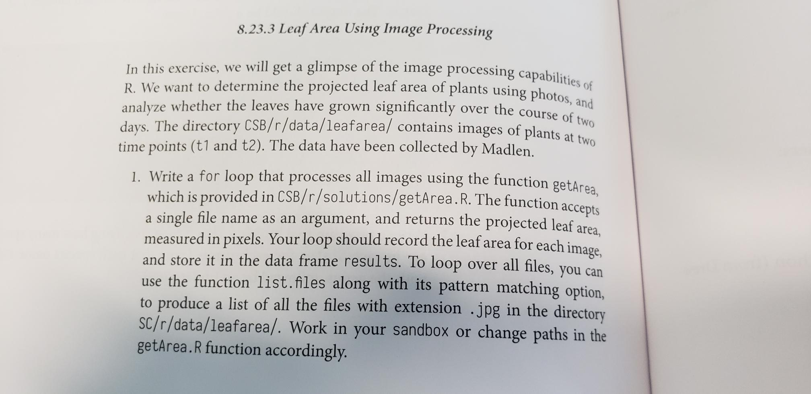
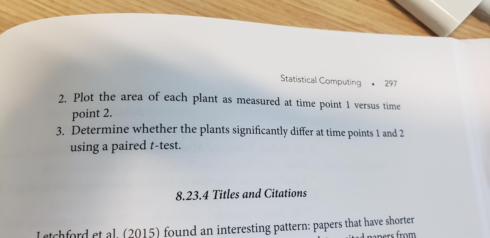

# Assignment 6: Leaf area (Needs Updating)

## Computer Preparation

* Open R-Studio

## Description of Assignment 

* Complete exercise 8.23.3 in the CSB text
_repalace the current assignment with a modified assignment based on this email_

```
Here are some tips to get assignment 6 set up.

1. Install Rtools by downloading the install package from the web then double clicking it and following the prompts.  This is a very large download and will take several minutes
2. While Rtools is downloading, set up your assignment repo

   a.	clone the repo 
   b.	copy the `r` dir in the CSB repo to your homework repo 
   c.	make an R script file in `r/sandbox` and open it 
   d.	add the "magic" line of code that we learned in the lecture for setting your working dir to the same location as your script, and run it 
   e.	read leaf area question

3. After Rtools is installed

   a.	Install EBImage by going to its github page (google search "github EBImage") and follow the install instructions 
   b.	then load EBImage with the library() command 
   c.	add a line of code to your script to "source" the file with the leaf area function, execute, and you should now see the function in the "environment" (upper right panel) 
   d.	try out the function by running it on in image (see question for the path to the leaf images)

4. You can consult the psuedo code and solutions to help you through this, they are in the `CSB/r` dir, but here are some additional hints for part 1

   a.	use list.files() to save the names of the images into a variable 
   b.	before the for loop, you need to create the data frame, define the columns, and save the empty dataframe into a variable 
   c.	inside the for loop, you need to add a vector containing the information for columns 1 and 2 to the next row of the data frame

       i.	ncol() returns the number of rows, ncol() + 1 is the "next row" 
       ii.	create a vector using c()

And you should be on your way.  Again, consult the pseudocode and solution if you get stuck, and try to understand what's happening.

Make sure you save your script!

Make sure you use git to log your changes to the assignment repo and push to github each time you walk away from your computer.  This is about building good habits, and saving your work just in case lightning strikes your computer.

Good luck!


```





## Submission

Submit updating this repo and pushing it to GitHub

```bash
#be sure to cd into your repo before running the following commands
git add --all
git commit -m "completed assignment!"
git push
```
